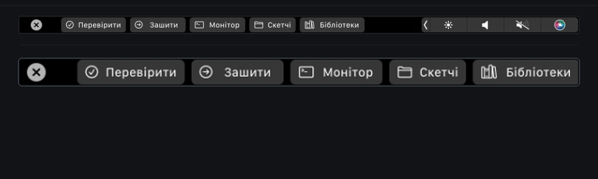
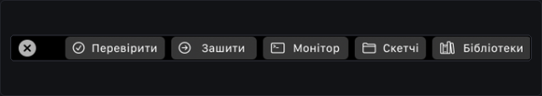
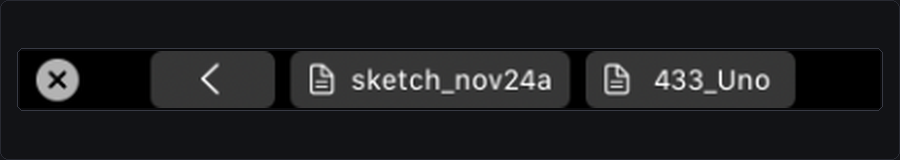
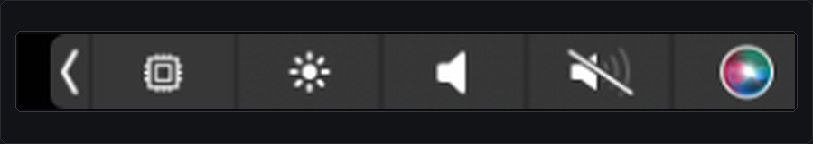

<div align="center">

[](https://stand-with-ukraine.pp.ua)

<p align="center">
  
</p>

# MacBook Pro Touch Bar for Arduino IDE
### ⚡ Compile, Upload, Serial Monitor, Libraries & Multi-Sketch Switcher

> [!IMPORTANT]
> 🔴 **HARDWARE REQUIREMENT / ВИМОГА ДО ПРИСТРОЮ**  
> Designed for **Apple MacBook Pro (2016–2020)** with physical **Touch Bar** running macOS Big Sur, Monterey, Ventura, Sonoma, or Sequoia.  
> Працює на всіх моделях MacBook Pro з сенсорною смугою Touch Bar!

[English Documentation](#-english) | [Custom Language Guide](#-custom-language-guide) | [Українська версія](#-українська-версія) | [Як налаштувати свою мову](#-як-налаштувати-свою-мову)

---
</div>

## 📸 Screenshots / Знімки екрана

| Mode / Стан | Touch Bar Preview |
| :--- | :--- |
| **Main Bar**<br>Головна панель (Verify, Upload, Monitor) |  |
| **Window Switcher**<br>Вибір скетчу |  |
| **Control Strip**<br>Іконка в треї |  |

---

<a name="english"></a>
## 🇬🇧 English

### ⚡ Overview
**ArduinoTouchBar** is a native macOS background utility providing comprehensive hardware Touch Bar controls for **Arduino IDE** (both 1.8.x and 2.x). Compile your code, flash microcontrollers, open the Serial Monitor, navigate libraries, and seamlessly switch between open sketch windows in a single tap.

### ✨ Key Features
- **✓ Verify / Compile:** Quick hardware trigger for `Cmd + R`.
- **➜ Upload:** Instant firmware flashing trigger for `Cmd + U`.
- **>_ Serial Monitor:** Instant access to `Cmd + Shift + M`.
- **📁 Sketchbook:** Quick open sketchbook with `Cmd + Shift + B`.
- **📚 Include Library:** Fast library inclusion shortcut `Cmd + Shift + I`.
- **🪟 Multi-Sketch Window Switcher:** Automatically detects when you have 2 or more Arduino sketches open. Displays an interactive switcher directly on the Touch Bar to jump between sketches.
- **⚡ Control Strip Companion:** Persistent CPU icon in the Control Strip for fast one-tap bar toggle.
- **🌐 Automatic Localization:** Automatically adapts to your system language (English by default, Ukrainian on Ukrainian macOS systems).
- **🔋 Zero Idle CPU Usage:** Reactively wakes up only when Arduino IDE is focused. 0.0% CPU when working in other applications.

### 🚀 Installation
1. Download **`ArduinoTouchBar-v1.0.0.zip`** from [Releases](https://github.com/mvmbmy0-gif/ArduinoTouchBar/releases).
2. Unzip and move `ArduinoTouchBar.app` to your Applications folder.
3. Open `ArduinoTouchBar.app`.
4. Grant Accessibility permission when prompted under **System Settings → Privacy & Security → Accessibility**.
5. Switch to Arduino IDE — your Touch Bar controls will light up instantly!

### 🛠️ Building From Source
```bash
git clone https://github.com/mvmbmy0-gif/ArduinoTouchBar.git
cd ArduinoTouchBar
./build.sh
```

---

<a name="custom-language-guide"></a>
## 🌍 Custom Language Guide (How to add or change language)

Adding a custom language or changing any button text takes less than 1 minute:

1. Open `main.m` in any text editor.
2. At the top of the file, locate the `kI18n` dictionary:
   ```objc
   static NSDictionary<NSString *, NSDictionary<NSString *, NSString *> *> *kI18n = @{
       @"en": @{
           @"verify":          @"Verify",
           @"upload":          @"Upload",
           @"serial":          @"Monitor",
           @"sketches":        @"Sketches",
           @"libraries":       @"Libraries",
           @"sketch_fallback": @"Sketch",
           @"menu_toggle":     @"Show / Hide Arduino Bar",
           @"menu_quit":       @"Quit ArduinoTouchBar"
       },
       // Add your language here! For example, German:
       @"de": @{
           @"verify":          @"Überprüfen",
           @"upload":          @"Hochladen",
           @"serial":          @"Serieller Monitor",
           @"sketches":        @"Skizzen",
           @"libraries":       @"Bibliotheken",
           @"sketch_fallback": @"Skizze",
           @"menu_toggle":     @"Arduino-Leiste ein-/ausblenden",
           @"menu_quit":       @"ArduinoTouchBar beenden"
       }
   };
   ```
3. To force your language, change:
   ```objc
   #define FORCE_LANGUAGE @"de"  // or @"en", @"uk", etc.
   ```
   *(Or leave `#define FORCE_LANGUAGE nil` to auto-detect from macOS settings!)*
4. Run `./build.sh` in the terminal to recompile. Done!

---

<a name="українська-версія"></a>
## 🇺🇦 Українська версія

### ⚡ Опис проєкту
**ArduinoTouchBar** — це нативна утиліта для macOS, яка перетворює Touch Bar вашого MacBook Pro на потужний інструмент розробника під **Arduino IDE**. Компілюйте скетчі, прошивайте мікроконтролери, запускайте монітор порту та миттєво перемикайтеся між відкритими вікнами скетчів в один дотик.

### ✨ Основні можливості:
- **✓ Перевірити (Компіляція):** Миттєвий запуск збірки скетчу (`Cmd + R`).
- **➜ Зашити (Прошивка):** Завантаження коду в плату (`Cmd + U`).
- **>_ Монітор порту:** Швидке відкриття Serial Monitor (`Cmd + Shift + M`).
- **📁 Скетчі:** Відкриття папки зі скетчами (`Cmd + Shift + B`).
- **📚 Бібліотеки:** Керування та додавання бібліотек (`Cmd + Shift + I`).
- **🪟 Перемикач скетчів:** Коли відкрито 2 або більше проектів Arduino, на Touch Bar з'являється кнопка перемикання з назвами ваших скетчів для швидкого переходу.
- **⚡ Іконка в Control Strip:** Фірмова кнопка в системній смузі поруч із регулятором звуку для швидкого відкриття панелі.
- **🌐 Автоматична локалізація:** Автоматично обирає українську мову на україномовних системах та англійську для решти світу.
- **🔋 0.0% навантаження на процесор:** Утиліта активується лише тоді, коли вікно Arduino IDE активне. У фоні вона спить і зовсім не розряджає батарею.

### 🚀 Встановлення та запуск:
1. Завантажте архів **`ArduinoTouchBar-v1.0.0.zip`** зі сторінки [Релізів](https://github.com/mvmbmy0-gif/ArduinoTouchBar/releases).
2. Розархівуйте та перемістіть `ArduinoTouchBar.app` у папку «Програми».
3. Запустіть додаток.
4. Надайте системний дозвіл у меню: **Системні параметри → Приватність і безпека → Спеціальні можливості (Accessibility)**.
5. Відкрийте Arduino IDE — кнопки з'являться на Touch Bar автоматично!

### 🛠️ Збірка проекту з вихідного коду:
```bash
git clone https://github.com/mvmbmy0-gif/ArduinoTouchBar.git
cd ArduinoTouchBar
./build.sh
```

---

<a name="як-налаштувати-свою-мову"></a>
## 🌍 Як налаштувати свою мову або змінити текст кнопок

Змінити назви кнопок або додати будь-яку іншу мову дуже просто:

1. Відкрийте файл `main.m` у будь-якому текстовому редакторі.
2. На самому початку файлу знайдіть блок `kI18n`:
   ```objc
   static NSDictionary<NSString *, NSDictionary<NSString *, NSString *> *> *kI18n = @{
       @"uk": @{
           @"verify":          @"Перевірити",
           @"upload":          @"Зашити",
           @"serial":          @"Монітор",
           @"sketches":        @"Скетчі",
           @"libraries":       @"Бібліотеки",
           @"sketch_fallback": @"Скетч",
           @"menu_toggle":     @"Показати / Сховати панель Arduino",
           @"menu_quit":       @"Вийти з ArduinoTouchBar"
       }
   };
   ```
3. Змініть назви на будь-які власні або додайте новий блок мови (наприклад, польську `"pl"`).
4. Щоб зафіксувати потрібну мову, вкажіть:
   ```objc
   #define FORCE_LANGUAGE @"uk"
   ```
5. Запустіть `./build.sh` у терміналі для швидкої перекомплікації.

---

### 📄 Ліцензія
Поширюється за відкритою ліцензією **MIT License**.  
Розроблено в Україні 🇺🇦.
